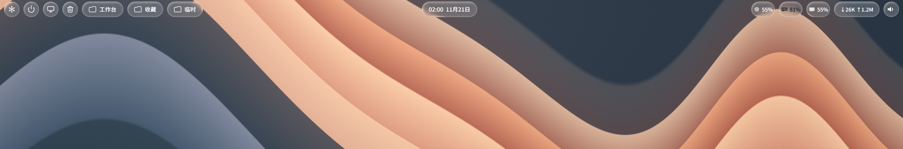
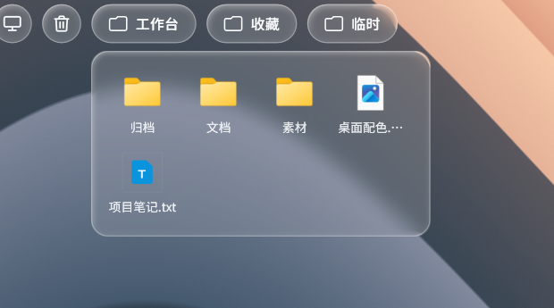
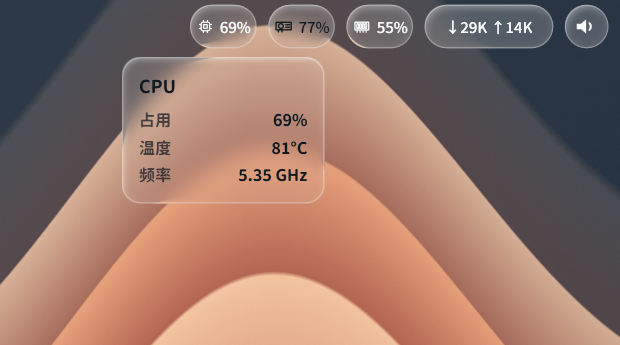
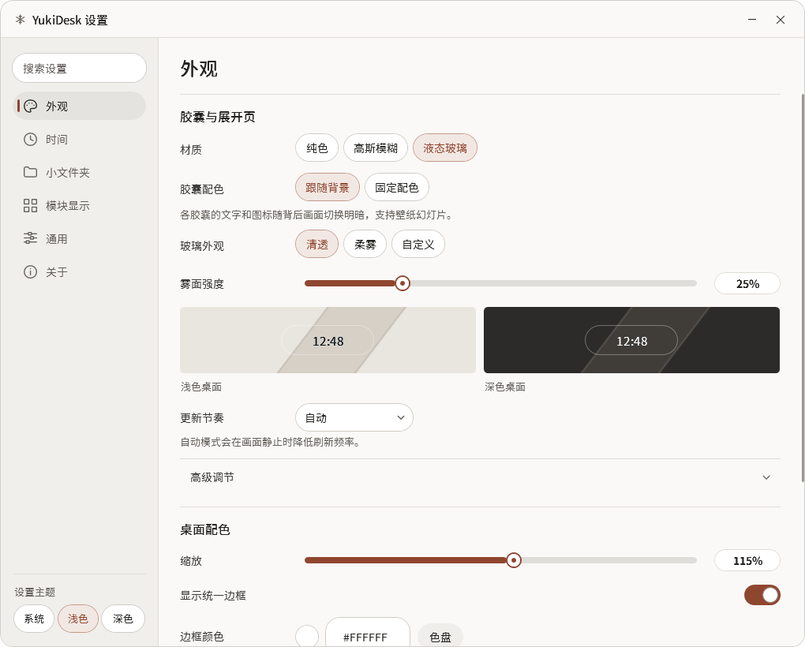
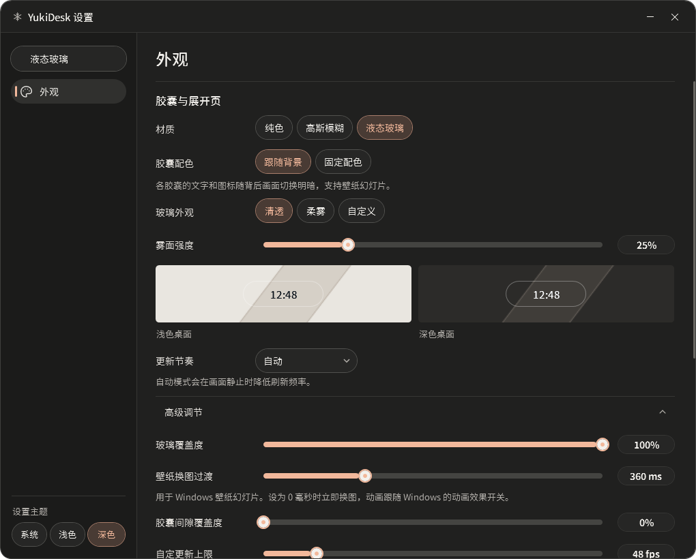

# YukiDesk

YukiDesk 是 Windows 桌面上的一条可自定义顶栏。它把小文件夹、时钟、音乐控制和性能监测放进一排胶囊里。普通窗口会盖过顶栏，回到桌面就能继续使用。

[下载最新版](../../releases/latest) · [2.0.0 更新公告](release-notes.md)

## 液态玻璃



在「设置 → 外观」选择「液态玻璃」，再选「清透」「柔雾」或「自定义」。胶囊和展开面板以背后的画面为底图，边缘能看到折射和高光。拖动「雾面强度」可调节清晰度，选择「跟随背景」可让胶囊文字和图标自动切换明暗。

Windows 壁纸幻灯片会触发玻璃底图过渡。「外观 → 高级调节 → 壁纸换图过渡」可在 0–1200 毫秒间调整，默认 360 毫秒。设为 0 会立即换图。

| 小文件夹 | 性能监测 |
| --- | --- |
|  |  |

## 功能

| 模块 | 用法 |
| --- | --- |
| 小文件夹 | 悬停展开。单击打开文件，也可把文件拖进胶囊或面板。默认移动，同名文件可以替换或保留为副本。 |
| 时钟 | 显示时间，可选秒数、日期和星期。悬停可查农历。 |
| CPU、GPU、内存与网络 | 胶囊显示当前占用或上下行速率，悬停查看详情。多显卡设备可选择监测对象。 |
| 音乐、频谱与音量 | 通过 Windows 媒体会话控制播放，显示系统音频频谱，调节当前默认输出设备的音量和静音。 |
| 回收站 | 单击胶囊展开，双击项目还原，也可以通过右键菜单操作。 |
| 系统工具 | 可在「模块显示」开关电源、此电脑等入口，也可以从托盘打开设置或管理顶栏显隐。 |

设置界面有浅色与深色秋叶配色，也可跟随 Windows。按 `Ctrl+F` 搜索设置页，按回车打开首个结果，按 `Esc` 清空查询。

| 浅色设置 | 深色设置与搜索 |
| --- | --- |
|  |  |

## 安装与更新

1. 在 [GitHub Releases](../../releases/latest) 下载与电脑架构对应的安装包。Intel 或 AMD 电脑选 `x64`，Windows on ARM 设备选 `arm64`。
2. `full` 自带 .NET 8 桌面运行时。已经安装对应架构的 [.NET 8 Desktop Runtime](https://dotnet.microsoft.com/download/dotnet/8.0) 时，可选体积较小的 `slim`。
3. 双击安装包即可。YukiDesk 默认安装到 `%LocalAppData%\Programs\YukiDesk`，按每用户安装。

已有 YukiDesk 时，可通过「设置 → 关于 → 检查更新」升级。程序根据当前架构和运行时类型选包，并校验发布页提供的 SHA-256。升级会保留配置和小文件夹数据。

配置与日志位于 `%AppData%\YukiDesk`。小文件夹默认位于 `%LocalAppData%\YukiDesk\MiniFolders`，可在设置里更改。顶栏运行在主屏桌面层。玻璃模式会把顶栏和面板从普通截图或录屏中排除，以免捕获到自身。

## 从源码构建

在装有 .NET 8 SDK 的 Windows 环境中执行以下命令。

```powershell
dotnet build -c Release
.\bin\Release\net8.0-windows10.0.19041.0\YukiDesk.exe
```

安装 Inno Setup 6 后运行 `.\packaging.cmd`，生成 x64、ARM64 的完整版与精简版，以及 SHA-256 清单。产物位于 `installers\`。

## 第三方组件

- [资源圆体（Resource Han Rounded SC）](https://github.com/CyanoHao/Resource-Han-Rounded) 随应用分发，详见 [SIL Open Font License 1.1](Assets/Fonts/ResourceHanRounded-OFL.txt)。
- [PawnIO](https://github.com/namazso/PawnIO) 是可选运行时，用于部分 AMD 平台的原生 CPU 温度。应用按需从官方发行版下载并校验签名。
- 内置 AMDFamily17 模块来自 [PawnIO.Modules](https://github.com/namazso/PawnIO.Modules)，二进制取自 [LibreHardwareMonitor](https://github.com/LibreHardwareMonitor/LibreHardwareMonitor) 的资源，适用 LGPL-2.1。

本项目使用 AI 辅助开发。
